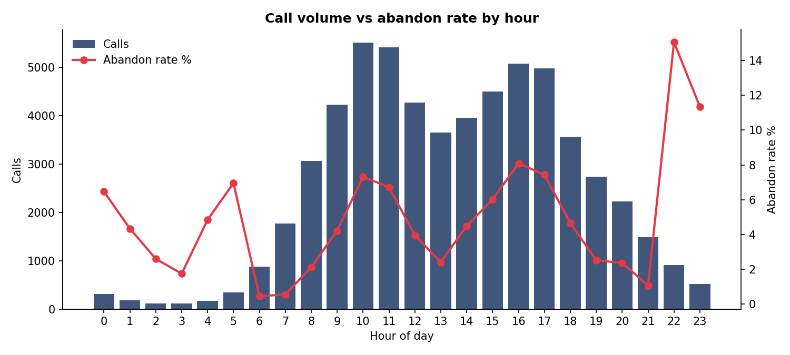
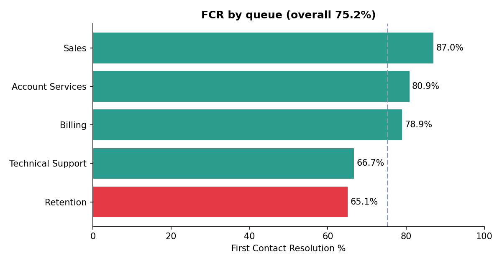
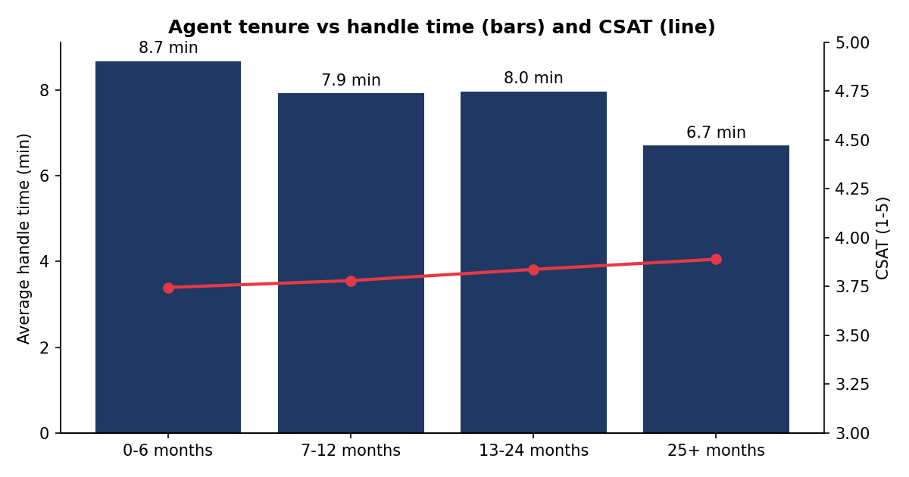
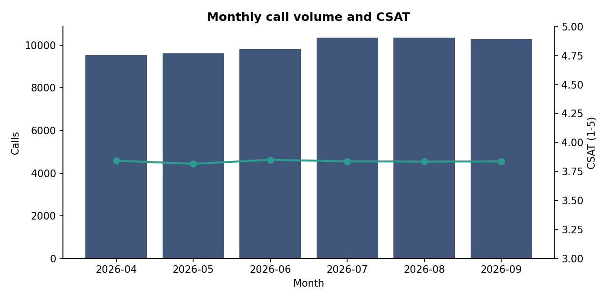
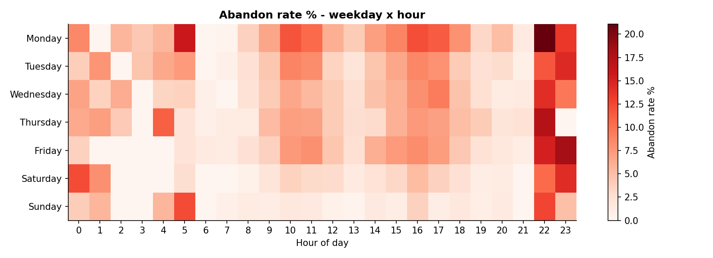

# 📞 Call Center Performance Analytics


---

**An end-to-end data analytics project** built with Python, MySQL, and Power BI — analysing ~60K call
center records to answer one business question:

> **Where and why are we losing customers (abandoned calls, low satisfaction), and what should operations change?**

---

## ⚠️ Dataset Note

The data is **synthetic**, generated by `src/generate_data.py`, because real call center data is private.
It is built with realistic patterns (peak hours, night-shift understaffing, agent tenure effects), so the
findings describe this simulated data and demonstrate the **method**, not real-world truth.

---

## 🚀 Quick Start (Local — No Database Needed)

### Prerequisites
- Python 3.10+
- pip

### Steps

```bash
# 1. Clone the repository
git clone https://github.com/tripathik9559/call-center-performance-analytics.git
cd call-center-performance-analytics

# 2. Create virtual environment
python -m venv venv
source venv/bin/activate          # Windows: venv\Scripts\activate

# 3. Install dependencies
pip install -r requirements.txt

# 4. Run the whole pipeline (generate → clean → analyse)
python src/run_pipeline.py
```

This creates the data, cleans it, and writes the charts and `outputs/key_insights.md`.

---

## 🐬 MySQL Deployment (Optional)

```bash
# Mac / Linux
DB_PASSWORD=your_mysql_password python src/run_pipeline.py --mysql

# Windows PowerShell
$env:DB_PASSWORD="your_mysql_password"; python src/run_pipeline.py --mysql
```

Then open **MySQL Workbench** and run, in order:
1. `sql/04_views_for_powerbi.sql`
2. `sql/03_analysis_queries.sql` (one query at a time)

---

## 🏗️ Project Structure

```
call-center-performance-analytics/
├── README.md
├── requirements.txt
│
├── data/
│   ├── raw/                     # Messy data, as exported
│   │   ├── calls_raw.csv
│   │   └── agents_raw.csv
│   └── clean/                   # Ready for SQL / Power BI
│       ├── calls_clean.csv
│       └── agents.csv
│
├── src/
│   ├── generate_data.py         # Step 1 - create synthetic raw data
│   ├── clean_data.py            # Step 2 - clean + feature columns + cleaning report
│   ├── eda_analysis.py          # Step 3 - KPIs, 5 charts, key_insights.md
│   ├── load_to_mysql.py         # Step 4 - create DB and load clean data
│   └── run_pipeline.py          # Runs everything in one command
│
├── sql/
│   ├── 01_schema.sql            # Tables, keys, indexes
│   ├── 03_analysis_queries.sql  # 13 business queries
│   └── 04_views_for_powerbi.sql # 3 views for Power BI
│
├── powerbi/
│   └── POWERBI_GUIDE.md         # Steps, DAX measures, 2-page layout
│
└── outputs/
    ├── charts/                  # 5 EDA charts (PNG)
    ├── key_insights.md
    ├── kpi_summary.csv
    └── cleaning_report.txt
```

---

## ✨ Features

### Data Cleaning (`clean_data.py`)
| Issue | Rows Affected | Action |
|-------|---------------|--------|
| Duplicate call records | 720 | Removed (kept first) |
| Inconsistent queue / status text | — | Standardised (e.g. `technical_support`, ` BILLING ` → clean names) |
| Missing queue values | 481 | Filled from agent's team (20 left as `Unknown`) |
| Negative handle times | 239 | Treated as sign errors, fixed with `abs()` |
| Impossible CSAT values (0, 7, 9) | 180 | Set to `NULL` |

**Feature columns added:** date parts, weekday, SLA flag, abandoned flag, 7-day repeat-caller flag

### SQL Analysis (MySQL 8)
- **13 business queries** using CTEs, window functions, joins, and aggregations
- **3 views** for Power BI: `vw_call_facts`, `vw_hourly_kpis`, `vw_agent_scorecard`
- Normalised schema with keys and indexes

### Power BI Dashboard
- Power Query for data loading and shaping
- DAX measures matching the Python and SQL KPI definitions
- **2-page layout** — Executive Overview + Agent & Queue Performance
- Full steps in [`powerbi/POWERBI_GUIDE.md`](powerbi/POWERBI_GUIDE.md)

---

## 📊 KPI Definitions

> Identical in Python, SQL, and DAX.

| KPI | Definition |
|-----|-----------|
| Abandon Rate | abandoned calls / total calls |
| SLA % | calls answered within 20 sec / total calls |
| AHT | average handle time of answered calls |
| ASA | average wait of answered calls |
| FCR % | answered calls resolved on first contact / answered calls |
| CSAT | average survey score (1–5), surveyed calls only |

---

## 📈 Results

**Period:** 01 Apr 2026 – 30 Sep 2026

| KPI | Value |
|-----|-------|
| Total Calls | 59,976 |
| Abandon Rate | 5.1% |
| SLA (answered within 20s) | 63.1% |
| Average Handle Time | 7.5 min |
| Avg Speed of Answer | 39 sec |
| First Contact Resolution | 75.2% |
| Average CSAT | 3.84 / 5 |
| Repeat Calls (within 7 days) | 12.5% |

### 🔍 Key Findings

| # | Finding | Detail |
|---|---------|--------|
| 1 | **Peak-hour abandonment** | 10:00 and 16:00–17:00 hit **7.6%** vs 5.1% overall; fixing saves ~**386 calls** |
| 2 | **Night shift understaffed** | 22:00–24:00 abandon rate is **13.7%** (2.7x overall) |
| 3 | **Monday is worst** | **7.9%** abandon rate; Sunday best at 1.6% |
| 4 | **Retention has lowest FCR** | **65.1%** (Sales best at 87.0%) |
| 5 | **New agents are slower** | 0–6 months: **8.7 min** vs 6.7 min (29% longer), FCR 65.5% vs 80.0% |
| 6 | **Waiting hurts satisfaction** | CSAT falls from **3.97** (≤20s wait) to **2.99** (>120s wait) |
| 7 | **Billing spikes early in month** | **124** calls/day on days 1–7 vs 91 later (36% higher) |

### 💡 Recommendations
- Add agents (or split breaks / shift starts) around **10:00, 16:00, 17:00** and on **Mondays**
- Roster more agents for the **22:00–24:00** window
- Add **Billing** capacity on days 1–7 of each month
- Fix root causes of repeat contacts in **Retention** (knowledge base, escalation path)
- Pair **new agents with a mentor** for their first 6 months

### 🖼️ Charts

| | |
|---|---|
|  |  |
|  |  |



---

## ⚙️ Environment Variables

All optional — defaults shown.

```env
DB_HOST=localhost
DB_PORT=3306
DB_USER=root
DB_PASSWORD=your_mysql_password
DB_NAME=call_center
```

---

## 🔧 Tech Stack

| Layer | Technology |
|-------|-----------|
| Language | Python 3.10+ |
| Data Processing | Pandas, NumPy |
| Visualisation | Matplotlib, Power BI |
| Database | MySQL 8 (CTEs, window functions, views) |
| BI Layer | Power BI (Power Query, DAX) |

---

## 🔮 Future Improvements
- Forecast hourly call volume to plan staffing
- Test the effect of added night-shift agents
- Replace the utilisation-based wait model with a full queueing simulation
- Run the pipeline on real data by mapping columns to `calls_raw.csv` and editing the cleaning rules

---

## ⚠️ Limitations
Findings come from simulated data, so they show the method, not real-world truth. The abandon-rate model
is a simplification (utilisation-based wait model, not a full queueing simulation).

---

## 👤 Author

**Kartikey Kumar Tripathi**

[GitHub](https://github.com/tripathik9559)

---

## 📝 License
For educational and portfolio use only.